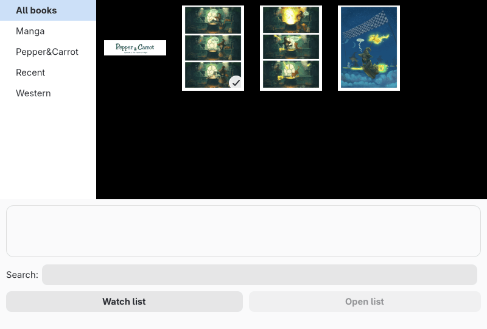

# Library

The library, CTRL+L, files books in collections and shows their covers.
A book is an archive in any format MComix opens; folders cannot be added.
Escape hides the window; CTRL+W closes it. In the search field, Escape first empties the search.

The covers are from "The Potion of Flight", episode 1 of [Pepper&Carrot](https://www.peppercarrot.com/) by David Revoy, [CC BY 4.0](https://creativecommons.org/licenses/by/4.0/), scaled down.

## Collections

- Collections are on the left; the selected one's books on the right, with those of the collections under it.
- "All books" holds every book.
- Drag a collection onto another to file it there, to any depth. Dropped on the edge of a row, it goes beside that collection.
- Drag books onto a collection to move them there from the collection on show; from "All books" they are added and stay where they were.
- Hold CTRL while dragging to copy them instead: they stay in the collection on show as well.
- A drag that starts on a selected cover takes every selected book; one that starts on another cover takes that book alone.
- "Recent" holds the books that are read, not books dragged onto it.
- "Add..." and books dropped from a file manager go into the collection on show; under "All books" or "Recent" they join no collection.
- Right-clicking a collection offers "Add...", "New", "Rename", "Duplicate", "Clean up", "Relocate..." and "Remove".
  - "Duplicate" makes a copy beside it, holding every book it shows.
  - "Clean up" drops books whose files are gone.
  - "Relocate..." follows a folder of books that was moved or renamed outside MComix; see below.
  - "Remove" keeps the books in the library, and moves the collections under it to the top.
  - F2 renames the selected collection; Delete removes it.

## A folder that moved

- The library holds a book by its path. A folder moved or renamed outside MComix leaves its books without their files.
- "Relocate...", in the collections' right-click menu, asks for the folder the books were in and the folder they are in now.
- Every book the library holds under the old folder follows, at any depth, whichever collection it is in.
- The books keep their collections, covers, bookmarks, the page they were left at, and the pages skipped, shown alone or turned.
- Watched folders under the old folder follow too.
- Where the missing books share one folder and no book in it is left, that folder is filled in.
- A book the library already holds at the new place stays where it was.

## Books

- The search field shows the books whose name or path contains its text, case aside, as soon as the typing pauses, or at once on Enter. CTRL+F goes to it.
- A book's cover is its first picture, or the first one named "cover" or "front". Pictures named "credit" or "banner" are passed over.
- To choose another, open the book, right-click the page and tick "Cover in the library". The book is not changed. Untick it there to go back.
- A book read to its last page has a tick on its cover.
- "Mark as read" in the books' right-click menu gives the selected books the tick; "Mark as unread" takes it away, with the page they were left at.
- The line under the covers gives the selected book's folder, size, page count, and the page it was left on or when it was finished.
- With no book selected, it counts the books on show: how many, how many were started and finished, the pages read, and when the last was read.
- A double click or Enter opens a book. Enter on one of several books picked out opens them all as one book, as "Open" does.
- Right-clicking the books offers "Open", "Open without closing library", "Mark as read", "Mark as unread", "Add...", "Clean up", "Copy", "Open containing folder", and three ways to take them out:
  - "Remove from this collection".
  - "Remove from the library".
  - "Remove and move to the trash": the only one that touches the files. They can be restored from the trash. Where the trash would refuse one, MComix asks to delete it permanently instead. It also takes them out of the recent files and asks about their bookmarks.
- "Copy", or CTRL+C, puts a single book's path and cover on the clipboard.
- Delete takes the selected books out of the collection on show, as "Remove from this collection" does. Under "All books" it does nothing.
- "Open containing folder" shows a single book in the file manager.
- "Sort" orders by name, full path, file size, date added, last read or by hand; "Cover size" sets how large covers are drawn. Books never read come last under "Last read"; "Descending" puts the latest read first.
- A middle click on a cover starts a second MComix on that book.
- A book opened from the library is one of the books shown. The next and previous archive are the next and previous of those, in the order shown, not of its folder. Past the last one shown there is no next.
- Reopened at the next start, by "Reopen the last book read" or "Save and quit", it still walks those books. Opened any other way, a book walks its folder.
- A RAR book in volumes is added as its first volume; the others are left out.
- An encrypted book is added without asking its password. Its cover is a padlock; the password is asked when it is opened.

## Reading lists

- A collection is a reading list once its books are put in order by hand.
- Choose "Sort", "By hand" in the books' right-click menu, then drag a cover onto another: it takes that cover's place.
- Dropped past the last cover, it goes last. Several selected covers move together.
- ALT+Left and ALT+Right move the selected books one place.
- Books nobody has placed follow the placed ones, by path. So does a book added later.
- The order is the collection's own: a book in two collections has a place in each.
- "All books" and "Recent" keep no order, and under another sort a drag between covers does nothing.
- Books of a collection under it follow, by path. They are put in order in their own collection.
- Opened from the library, the books are read in that order: the next archive is the next cover.
- "Duplicate" keeps the order.

## Watched folders

- "Watch list", at the bottom of the library window, names folders to look in for new books, each with its collection and whether subfolders are searched.
- "Remove", or Delete, takes the selected folder off the list. Its books stay in the library.
- "Scan now" searches at once; closing an edited list searches too.
- With "Automatically scan for new books when library is opened", the search runs whenever the library opens.

## Recent books

- While "Remember recently opened files" is on, every archive opened joins the "Recent" collection with the page it was left at.
- That page is remembered by its picture, so re-sorting the archive does not move it.
- "Never" stops this, and offers to clear what is kept.
