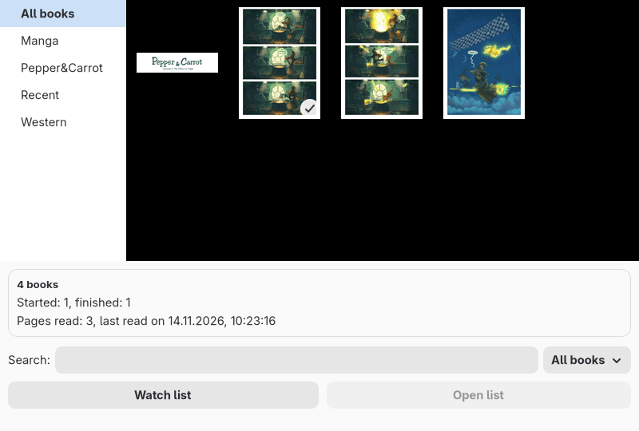

# Library

The library, CTRL+L, files books in collections and shows their covers.
A book is an archive in any format MComix opens; folders cannot be added.
Escape hides the window; CTRL+W closes it. In the search field, Escape first empties the search.
While no book is open, the main window shows the covers of "Recent" itself, or of "All books" where nothing has been read. "Collection" in the covers' right-click menu shows another collection instead, or every book, and the main window keeps showing it until another is picked. A double click or Enter opens one, and the right-click menu is the library's. Files dropped on the covers open as on a page. CTRL+F there opens a search field over the covers, which looks among every book by name or path; Escape closes it. Letters typed over the covers stay the window's shortcuts. Books are added in the library window; "Add to collection" and "Move to collection" file them from there as well. [Preferences](preferences.md) turns this off.

The covers are from "The Potion of Flight", episode 1 of [Pepper&Carrot](https://www.peppercarrot.com/) by David Revoy, [CC BY 4.0](https://creativecommons.org/licenses/by/4.0/), scaled down.

## Collections

- Collections are on the left; the selected one's books on the right, with those of the collections under it.
- "All books" holds every book.
- The library opens on the collection on show when it last closed, or on "All books".
- Drag a collection onto another to file it there, to any depth. Dropped on the edge of a row, it goes beside that collection.
- Drag books onto a collection to move them there from the collection on show; from "All books" they are added and stay where they were.
- Hold CTRL while dragging to copy them instead: they stay in the collection on show as well.
- Without dragging, "Add to collection" in the books' right-click menu files the selected books in a collection and leaves them where they were; "Move to collection" takes them out of the collection on show as well, and is not offered in "All books". Each lists every collection but the one on show and "Recent", one under another as "Box / Inner", and "New collection...", which asks for a name and files the books in the collection made. The main window's covers offer both as well, where a name refused is said in a message of its own.
- A drag that starts on a selected cover takes every selected book; one that starts on another cover takes that book alone.
- "Recent" holds the books that are read, not books dragged onto it.
- "Add..." and books dropped from a file manager go into the collection on show; under "All books" or "Recent" they join no collection.
- Right-clicking a collection offers "Add...", "New", "Rename", "Duplicate", "Clean up", "Relocate..." and "Remove".
  - "Duplicate" makes a copy beside it, holding every book it shows.
  - "Clean up" drops books whose files are gone from a drive that is connected, even where their whole folder was deleted. Books on a drive not connected are kept; the status line says how many.
    A drive is known by where it is mounted (on Windows, its letter) and by the books MComix last found on it. Another drive under the same letter takes nothing.
    A folder moved away is gone too: use "Relocate..." first.
  - "Relocate..." follows a folder of books that was moved or renamed outside MComix; see below.
  - "Remove" keeps the books in the library, and moves the collections under it to the top.
  - F2 renames the selected collection; Delete removes it.

## A folder that moved

- The library holds a book by its path. A folder moved or renamed outside MComix leaves its books without their files.
- "Relocate...", in the collections' right-click menu, asks for the folder the books were in and the folder they are in now.
- Every book the library holds under the old folder follows, at any depth, whichever collection it is in.
- The books keep their collections, covers, bookmarks, the page they were left at, and the pages skipped, shown alone or turned.
- Watched folders under the old folder follow too.
- Where the missing books share one folder and no book in it is left, that folder is filled in.
- A book the library already holds at the new place stays where it was.

## Books

- The search field shows the books whose name or path contains every word typed, case aside, as soon as the typing pauses, or at once on Enter. CTRL+F goes to it.
- Typing a letter or digit over the covers starts a search with it.
- The choice beside the search field shows all books, or only the unread, started or finished ones. It holds together with the search, in every collection.
  A book left past its first page is started; one left on its last page is finished.
- A book's cover is its first picture, or the first one named "cover" or "front". Pictures named "credit" or "banner" are passed over.
- To choose another, open the book, right-click the page and tick "Cover in the library". The book is not changed. Untick it there to go back.
- A book read to its last page has a tick on its cover.
- A book whose file is not there, as on a drive not connected, has its cover drawn in grey and faded. Showing the covers looks again, and a book that has come back is drawn as before.
- "Mark as read" in the books' right-click menu gives the selected books the tick; "Mark as unread" takes it away, with the page they were left at.
- The line under the covers gives the selected book's folder, size, page count, and the page it was left on or when it was finished.
- With several books selected, it sums them up: how many, their pages and size together, and how many of them are started and finished.
- With no book selected, it counts the books on show: how many, how many of them are started and how many finished, the pages read, and when the last was read.
- A double click or Enter opens a book. Enter on one of several books picked out opens them all as one book, as "Open" does.
- Right-clicking the books offers "Open", "Open without closing library", "Mark as read", "Mark as unread", "Add...", "Add to collection", "Move to collection", "Copy", "Open containing folder", "Rename", "Move to", "Properties", and "Open with" where [external commands](external-commands.md) are set up.
- Its "Free up space" submenu holds "Make pages smaller without loss...", "Shrink oversized pages...", "Repack as ZIP..." and "Find duplicates...".
- Its "Remove" submenu holds four ways to take books out, and "Clean up":
  - "Remove from this collection".
  - "Remove from the library".
  - "Remove and move to the trash": the files go to the trash, from where they can be restored. Where the trash would refuse one, MComix asks to delete it permanently instead. It also takes them out of the recent files and asks about their bookmarks.
  - "Delete permanently", or SHIFT+Delete: as the trash, but the files are deleted for good and cannot be restored. Cancel is the default.
- "Select books" in the same menu selects every book on show, those with no pages (an archive of videos, say, added before the library refused such books), or those whose file is not there: deleted or moved outside MComix, or on a drive not connected. Then move or remove them together.
- "Select books > Books that cannot be read in full..." reads every file of each book on show, a few books at once, and lists those that cannot be read: damaged (with how many of its files cannot be read; their names are in the row's tooltip), encrypted (no password is asked for), not an archive at all, or in a format nothing installed here reads. Stop lists what was found so far. "Select in Library" selects them, to move, repair or remove together. The files are unpacked into the system's temporary folder, or the unpack folder the preferences name, and each is deleted again as it comes out; nothing is written in the library.
- "Copy", or CTRL+C, puts a single book's path and cover on the clipboard.
- Delete takes the selected books out of the collection on show, as "Remove from this collection" does. Under "All books" it does nothing.
- "Open containing folder" shows a single book in the file manager.
- "Rename", or F2, renames a single book's file, as "Rename archive..." in the main window does: the library, bookmarks and the page it was left at follow it, and the book being read is reopened under its new name.
- "Move to" moves the selected books into another folder, offering the folders the main window's "Move to" offers. What is recorded of each follows it, and the book being read is reopened where it landed.
- "Make pages smaller without loss..." writes the selected books again with each PNG or GIF page a lossless WebP and each JPEG page optimised without loss, where that keeps every pixel and is smaller (the same test as in [Saved archives](editing.md#saved-archives)). Nothing else in a book changes: every other file stays as it was, a page keeps its name but for the extension, no ComicInfo.xml is added, and a CBZ stays a CBZ. It is offered where at least one selected book is in a format MComix can write. Bookmarks, page marks and turns, the chosen cover and the page a book was left at follow the renamed pages.
  - A book with a file that cannot be read, being damaged, is left as it was: written over, it would lose what another tool could still recover from that file. The summary counts it among the damaged books.
  - "Also write books that have damaged files, leaving those files out", in the question asked first, writes them without those files instead. The summary counts such books, and the saved log names each file left out. The choice is kept for the next time. A full disk or a refused folder fails the book either way.
  - It asks first, naming how many books, since it can be given a whole library and take hours.
  - While it runs it shows the book it is on, how far it is over all of them, how many it has stored, the room saved and, after a few seconds, about how long is left. Stop, or closing the window, keeps every book already done and leaves the one being written as it was.
  - It ends with a summary that counts the books left as they were by reason: no PNG, GIF or JPEG pages (as in a book of WebP pages done before), no page made smaller (as in a book with JPEG pages done before), encrypted, archives inside, split into volumes, damaged or not an archive, a format MComix does not write (such as PDF, EPUB or LHA, named), the program that writes the format not installed (rar for a RAR, 7z for a 7z), or open in the main window. It names up to ten books that could not be written, one to a line.
  - "Save Log…" then writes a text file listing every book under what became of it: stored, stored without damaged files, left as it was and why, not written and the error, or not yet looked at. The books it left alone can be found there to repack by hand.
  - "Select Books with Errors", offered where there are any, closes the summary and selects the books that could not be written, were written without damaged files, or could not be read at all, to move or remove them together.
  - The book open in the main window has the same command in its File menu: see [Reading](reading.md).
- "Shrink oversized pages..." makes the pages of the selected books that are taller than a limit as high as the limit, as WebP, for books scanned at far more pixels than any screen shows. Unlike the command above it loses detail, so it writes nothing before the books it would change have been listed. It is offered where "Make pages smaller without loss..." is.
  - It asks first for the height limit in pixels (4320 to begin with, twice the height of a 4K screen), the WebP quality (90 to begin with) and the least share of a book, in percent, it has to save to be ticked (25 to begin with), and keeps all three for the next time. A long strip, far higher than wide, is judged by its width alone: it is narrowed to two thirds of the limit where it is wider than that, and never cut down by its height. A spread, wider than high, is judged by its height like any other page.
  - "Find Books" reads each book, with Stop, and lists those with a page over the limit, with how many such pages it has and about how much smaller it would be, in size and as a share of the book, from a few of its pages shrunk to try. A book is ticked where it would save at least the share set: one of a few large pages among many small ones, which would go from 40 MiB to 35 MiB, is listed unticked, since its pages would lose detail for an eighth of its size. The total to save counts the books ticked. The books left out are counted by reason, as in the summary above, with one more: no page over the limit.
  - "Shrink" writes the books left ticked, with the progress, Stop, summary and log of the command above. Each page over the limit becomes a WebP of the same name but for the extension; a page that would come out no smaller, an animated page, or one whose colours a WebP would not keep (CMYK, 16 bits a channel, a gamma of its own) is left as it was, and so is every other file. Each book written goes to the trash as it was, from where it can be restored; where the trash would refuse it, it is left as it was.
  - The trash keeps the room the books took until it is emptied, so a long run takes more of the disk the further it goes. Before writing, "Shrink" adds up what the books ticked will take once shrunk; where a disk has less room free, it asks first, and "Delete Originals Permanently" replaces each book in place instead of trashing the book as it was. Cancel is the default.
  - Once a book cannot be written for want of room, the run stops there, and the summary says the disk is full; the books not yet looked at can be shrunk again once the trash is emptied.
- "Repack as ZIP..." writes the selected books again as ZIP, with every file in them as it was: a page already compressed (JPEG, PNG, WebP, GIF, AVIF) is stored, and anything else is compressed where that pays. It asks first. It is offered where at least one selected book is an archive of files, which a PDF or an ebook is not; a RAR needs no rar program for it.
  - A RAR, 7z, tar or LHA book is replaced by the ZIP: book.cbr, book.cb7 or book.cbt becomes book.cbz, and any other name ends in .zip in its place. The old file is removed, not put in the trash, since the ZIP holds all of it; the ZIP is read back first, every file in it checked, and a ZIP that does not read back whole leaves the book as it was. A book whose new name is taken by another file, or that is reached through a symbolic link, is left as it was, and so is one with a file that cannot be read, unless "Also write books that have damaged files" is ticked, as above: the ZIP would be written without it, and the old archive, which still holds what can be got out of it, removed. The library, bookmarks, page marks and turns, the chosen cover and the page a book was left at follow it to its new name.
  - A ZIP is written again under its own name only where that makes it smaller, as for a CBZ whose pages were compressed again or whose text was not.
  - The progress, Stop, summary and log are those of "Make pages smaller without loss...". The summary says how much larger the books came out where they did, as a 7z can be smaller than the ZIP of the same files.
- "Find duplicates..." looks for copies among the books on show, whatever is selected: the whole library under "All books", or a collection, or what a search found. It reads the first four pages of each book, which in a large library takes minutes; what it read is kept in the library, so the next search reads only the books added or changed since. Stop compares what was read so far.
  - It finds three kinds of copies, each group under its kind: the same file; the same pages packed again, as a CBR repacked as a CBZ; and pages that look the same, as a book scanned again, shrunk, recompressed, turned or mirrored. A page that many books share, as a group's credits page, or a page with nothing on it, is no reason to take two books for copies.
  - Each book is listed with its cover, name, folder, size, pages and the size of its first page. In each group the copy to keep is marked (the one of most pages, then of the largest pages, then the smallest file) and the others are ticked; the ticks can be changed.
  - "Select in Library" closes the window and selects the books ticked, to move, trash or remove them with the commands above. "Remove from Library" asks first, then takes them out of the library and leaves their files where they are. "Put All in a Collection" puts every book listed, ticked or not, into the collection "Duplicates", made if there is none, to go through later. Activating a book's row opens it, and the library stays open.
- "Properties", or ALT+Return, describes the selected book: its file, format and pages, when it was added and last read, its collections, and what its ComicInfo.xml says. Several books are summed up: how many, their pages and size, how many were started and finished, and their folder where they share one.
- "Sort" orders by name, full path, file size, pages, date added, date modified (the file's own date), last read or by hand; "Cover size" sets how large covers are drawn. Books never read come last under "Last read", and books whose file is gone under "Date modified"; "Descending" puts the latest read first.
- A middle click on a cover starts a second MComix on that book, as "Open in a new window" in the right-click menu does for the one book selected.
- A book opened from the library is one of the books shown. The next and previous archive are the next and previous of those, in the order shown, not of its folder. Past the last one shown there is no next.
- Reopened at the next start, by "Reopen the last book read" or "Save and quit", it still walks those books. Opened any other way, a book walks its folder.
- CTRL+Enter opens the selected book as if it were opened from its folder: the next and previous archive are those of its folder, in natural order. CTRL and a double click open a cover so, as does "Open among its folder's books" in the right-click menu. A middle click does the same in a second MComix. "Go → Books in library order" (CTRL+SHIFT+L) switches between the two once the book is open.
- A book that cannot be read, or one with no picture in it (an archive of videos, say), is not added. The status bar names it.
- A RAR book in volumes is added as its first volume; the others are left out.
  Deleting, moving or renaming the book takes all of its volumes.
- An encrypted book is added without asking its password. Its cover is a padlock; the password is asked when it is opened.

## Reading lists

- A collection is a reading list once its books are put in order by hand.
- Choose "Sort", "By hand" in the books' right-click menu, then drag a cover onto another: it takes that cover's place.
- Dropped past the last cover, it goes last. Several selected covers move together.
- ALT+Left and ALT+Right, or ALT+KeyPadLeft and ALT+KeyPadRight, move the selected books one place.
- Books nobody has placed follow the placed ones, by path. So does a book added later.
- The order is the collection's own: a book in two collections has a place in each.
- "All books" and "Recent" keep no order, and under another sort a drag between covers does nothing.
- Books of a collection under it follow, by path. They are put in order in their own collection.
- Opened from the library, the books are read in that order: the next archive is the next cover.
- "Duplicate" keeps the order.

## Watched folders

- "Watch list", at the bottom of the library window, names folders to look in for new books, each with its collection and whether subfolders are searched.
- "Remove", or Delete, takes the selected folder off the list. Its books stay in the library.
- "Scan now" searches at once; closing an edited list searches too.
- The status bar says how many books were added, and names those that could not be, such as a damaged archive. Later searches pass over those until the file changes or MComix starts again.
- A book that has been read, and so is in "Recent" alone, is filed in the folder's collection by the next search. A folder watched into no collection leaves it as it is.
- Each search also follows a book moved or renamed within the folder, found by its name and size, with its collections, cover, bookmarks and the page it was left at, and removes a book deleted from it.
  Books on a drive not connected are kept. A watched folder that is not there is left alone, for "Relocate..." to follow.
- With "Automatically scan for new books when library is opened", the search runs whenever the library opens.
  While the library is open, the folders are watched too: a book copied or moved into one, or into a new subfolder of one searched with its subfolders, is added a moment after it has arrived, and one deleted or moved away is followed or removed as the search does. The first 1000 folders are watched; a deeper library is still searched whenever it opens.

## Recent books

- While "Remember recently opened files" is on, every archive opened joins the "Recent" collection with the page it was left at.
- That page is remembered by its picture, so re-sorting the archive does not move it.
- Turning it off stops this, and offers to clear what is kept.
